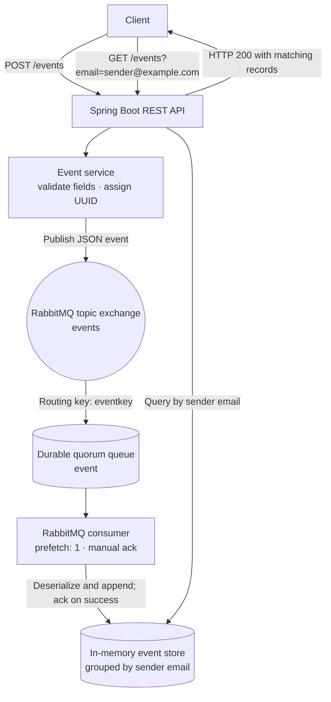

# Async Event API

A Spring Boot API that accepts email-style event records, publishes them to RabbitMQ, and returns records grouped by sender email. The consumer processes each queued event asynchronously.

> **Current behavior:** this project does not send email through an SMTP server or email provider. It queues and stores the `senderEmail`, `receiverEmail`, and `message` fields as event data.

## Architecture



`POST /events` returns after publishing the message. RabbitMQ then delivers it to the consumer, which stores it in memory and acknowledges the message after a successful write. If processing fails, the consumer rejects the delivery and requeues it.

## API

| Method | Endpoint | Purpose |
| --- | --- | --- |
| `POST` | `/events` | Validate and enqueue an event. The API generates its `id`. |
| `GET` | `/events?email=<sender-email>` | Return events whose `senderEmail` matches the query value. |

Example request:

```bash
curl -X POST http://localhost:8080/events \
  -H 'Content-Type: application/json' \
  -d '{"senderEmail":"sender@example.com","receiverEmail":"recipient@example.com","message":"Hello"}'
```

Example query:

```bash
curl 'http://localhost:8080/events?email=sender%40example.com'
```

The consumer is asynchronous, so allow a short moment after a successful `POST` before querying for the event.

## Run locally

Requirements: Docker with Docker Compose, and Java 17 if running the app outside Compose.

```bash
docker compose up --build
```

Compose starts RabbitMQ and then the app after RabbitMQ passes its health check. The consumer declares the `events` exchange, the `event` queue, and their `eventkey` binding automatically.

- Swagger UI: <http://localhost:8080/swagger-ui/index.html>
- RabbitMQ management: <http://localhost:15672/> (`guest` / `guest` for the local default credentials)
- App API: <http://localhost:8080/events>

Stop the services with:

```bash
docker compose down
```

## Data storage

Events are held in an in-memory map keyed by `senderEmail`. They are available only while the application process is running and are cleared when it restarts. RabbitMQ provides the queue between publishing and processing; this project does not use a persistent event database.
